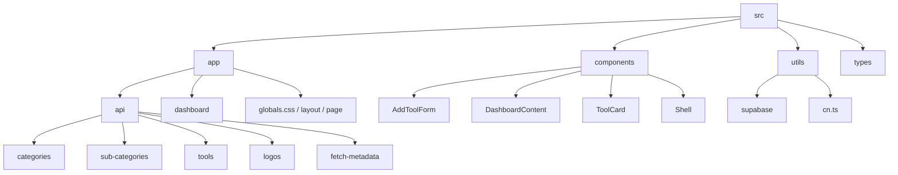

# 🛠️ dev-toolkit

A modern, high-performance developer tool-stash and link directory built to organize, search, and manage web development tools and links efficiently.

---

## ✨ Features

- **🚀 Modern UI/UX:** Built with Tailwind CSS, supporting elegant layouts, interactive search, and category grouping.
- **Categorized Tool Stash:** Browse category folders at `/dashboard`, direct websites and sub-folders at `/dashboard/[categoryId]`, and nested websites at `/dashboard/[categoryId]/[subCategoryId]`. Folder URLs use stable database IDs.
- **🔗 Meta Fetching:** Dynamic API endpoints to fetch websites' metadata and logos seamlessly.
- **⚡ Supercharged Backend:** Fully integrated with Supabase for fast, reliable data persistence and SSR capabilities.
- **⚙️ Developer Dashboard:** Full CRUD capabilities for adding, updating, and removing developer tools/links.
- **Folder-scoped navigation:** Sub-folder contents stay hidden until opened. Search only examines the current level. New sub-folder creation is enabled inside category folders and automatically uses the current category; Add Link preselects the current category and sub-folder.
- **Empty folder deletion:** Folder cards offer a Shadcn delete confirmation. Stored websites block deletion, including websites inside a category's sub-folders. Delete empty sub-folders before deleting their parent category. Both DELETE endpoints recheck contents and return HTTP 409 when occupied.
- **Website preview states:** Cards display a loading message while fetching the preview and a clear unavailable state if both the stored preview and screenshot fallback fail. The website link remains accessible.
- **Notebook:** `/notebook` stores plain-text notes in Supabase with create, read, edit, delete, and copy actions. Whitespace and line breaks are preserved. Desktop and mobile navigation include Notebook.

### Notebook database setup

Run `supabase/migrations/202610120001_notebook.sql` in your project's Supabase SQL Editor before using Notebook. The application publishable key cannot create database tables. Until the migration is applied, Notebook displays a database setup error rather than pretending to save locally.

Notebook is intentionally public: anonymous visitors can read, create, update, and delete notes. Do not store secrets or personal data. Clipboard copy requires browser permission and a secure context (HTTPS or localhost); if blocked, select the displayed text and copy manually.


---

## 🎨 Tech Stack

| Technology | Purpose |
| :--- | :--- |
| **Next.js 16 (Turbopack)** | React Framework with App Router & server component routing. |
| **Supabase Client & SSR** | Cloud Database, authentication, and SSR-safe helper utilities. |
| **Tailwind CSS v4** | Next-generation CSS utility framework for rapid styling. |
| **TypeScript** | Strict static type-safety across endpoints and components. |

---

## 🏗️ Directory Structure



---

## 🚀 Getting Started

### 1. Clone the repository

```bash
git clone https://github.com/Cattus9/dev-toolkit.git
cd dev-toolkit
```

### 2. Configure Environment Variables

Create a `.env.local` file in the root directory:

```env
NEXT_PUBLIC_SUPABASE_URL=your-supabase-url
NEXT_PUBLIC_SUPABASE_ANON_KEY=your-supabase-anon-key
```

### 3. Install Dependencies

```bash
npm install
```

### 4. Run Development Server

```bash
npm run dev
```

Open [http://localhost:3000](http://localhost:3000) to view it in the browser.

---

## 🛠️ Scripts

- `npm run dev` - Starts the development server with Turbopack.
- `npm run build` - Creates an optimized production build.
- `npm run start` - Starts the production server.
- `npm run lint` - Runs ESLint to check for code issues.

---

## 🤝 Contributing

Contributions are welcome! Please open an issue or submit a pull request with your suggested changes.
